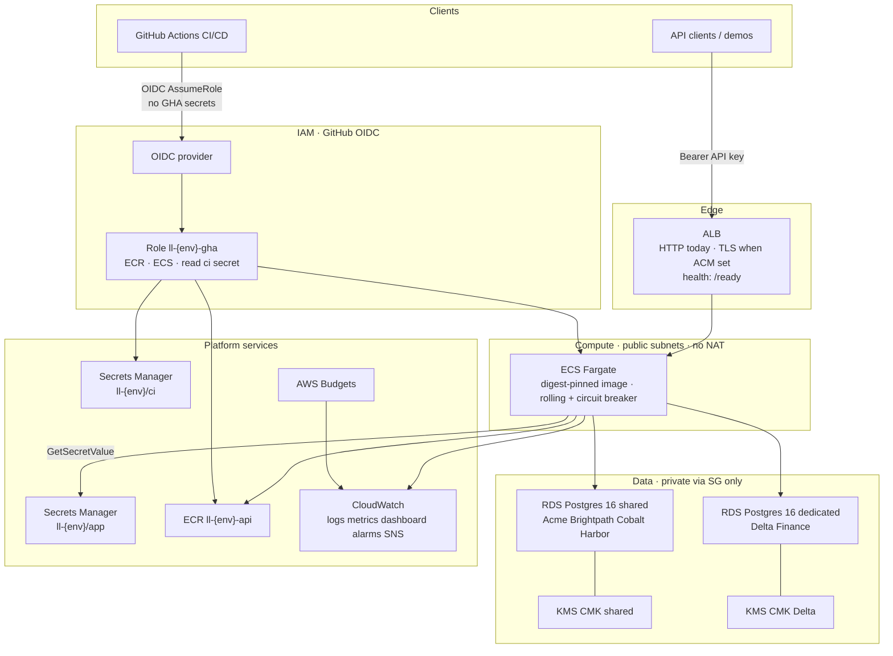

# Ledgerline Platform

Predixion AI — **Founding Reliability Engineer** live assessment.

Secure, multi-tenant B2B SaaS API: FastAPI + Postgres on AWS (`ap-south-1`), shared and dedicated tenant tiers, CI/CD, observability, timed restore, load evidence, runbooks, and a deterministic **Reliability Autopilot**.

| Doc (in this repo) | Purpose |
|--------------------|---------|
| [`SECURITY.md`](SECURITY.md) | Flaws found and fixes |
| [`docs/security-questionnaire.md`](docs/security-questionnaire.md) | Delta Finance answers |
| [`docs/runbooks/`](docs/runbooks/) | Onboard, restore, IR, deploy/rollback |
| [`docs/COST_MODEL.md`](docs/COST_MODEL.md) | Shared vs dedicated cost |
| [`docs/90_DAY_PLAN.md`](docs/90_DAY_PLAN.md) | First 90 days + first hire |
| [`docs/post-incident-review.md`](docs/post-incident-review.md) | Blameless PIR |
| [`docs/evidence/`](docs/evidence/) | Saved command/output evidence |
| [`AGENTS.md`](AGENTS.md) | How agents work this repo |

---

## Live endpoints (keep up until live session)

| Env | ALB | Notes |
|-----|-----|--------|
| **Staging** | `http://ll-staging-alb-1605781679.ap-south-1.elb.amazonaws.com` | Primary evidence / incident drill |
| **Production** | `http://ll-production-alb-2062045131.ap-south-1.elb.amazonaws.com` | Same modules; lean apply for dual-env parity |

Smoke: `GET /ready` → `{"status":"ready"}`.  
Auth: `Authorization: Bearer <lab_api_key>` (keys shared with reviewers out-of-band — not committed).

---

## Architecture

### AWS (staging shown · production uses the same modules / `ll-production-*`)



**Runtime**

1. Client → **ALB** → **ECS Fargate**.  
2. Task reads **Secrets Manager** `ll-{env}/app` (DB URL, admin token, pepper).  
3. Shared tenants → shared RDS; Delta → dedicated RDS + KMS.  
4. JSON logs + `/metrics` → CloudWatch.

**CI/CD**

1. **CI** ([`.github/workflows/ci.yml`](.github/workflows/ci.yml)): pytest, pip-audit, Trivy, terraform validate; SonarCloud via OIDC → ASM when token present.  
2. **CD** ([`.github/workflows/cd.yml`](.github/workflows/cd.yml)): manual `workflow_dispatch` → OIDC → ECR tag → ECS digest deploy / tag rollback.  
3. No long-lived AWS keys in GitHub Secrets — OIDC + ASM only.

**Tenants**

| Tier | Demo tenants | Isolation |
|------|----------------|-----------|
| Shared | Acme, Brightpath, Cobalt, Harbor | App-layer `tenant_id` + API keys |
| Dedicated | Delta | Own RDS + own KMS + audit |

**Auth:** Bearer API key → peppered SHA-256 → server-derived `tenant_id`. `X-Tenant-Id` never grants access (mismatch → **403**).

**Network:** public subnets + task public IP (no NAT); RDS not publicly accessible.

---

## Tech stack

| Layer | Choice |
|-------|--------|
| API | FastAPI / Python 3.12 |
| DB | Postgres 16 on RDS `db.t4g.micro` |
| Compute | ECS Fargate |
| Edge | ALB (`/ready` health) |
| Secrets | AWS Secrets Manager |
| Crypto | KMS CMKs (shared + per dedicated tenant) |
| CI/CD | GitHub Actions + OIDC |
| IaC | Terraform — **staging and production both applied** (lean) |
| Load | k6 |
| Autopilot | Local deterministic CLI (dry-run, kill switch) |

---

## Approach

1. **Depth over breadth** — security + reliability evidence before stretch goals.  
2. **Never trust headers** — real API keys; isolation tests in CI.  
3. **Dual env from same modules** — staging for deep drills; production lean for Task 1.2 parity.  
4. **Honest SLOs** — measure, fix, re-measure; document lean vs capacity profiles.  
5. **Gates** — `APPROVE_APPLY` / `APPROVE_RESTORE` / `APPROVE_AUTOPILOT` before billable/risky actions.

---

## Application (high level)

| Route | Behavior |
|-------|----------|
| `POST/GET /records` | Tenant-scoped; list `LIMIT` (default 50) |
| `GET /records/{id}` | `id` **and** `tenant_id` |
| `GET /reports/heavy` | Noisy-neighbour drill; concurrency cap |
| `/health` · `/ready` | Liveness · DB ping |
| `/metrics` | Prometheus (bounded labels) |
| `/admin/...` | Admin Bearer + append-only audit |

---

## Benchmarks & evidence (staging)

| Test | Result | Evidence |
|------|--------|----------|
| Isolation | pytest green in CI | [`docs/evidence/phase2/`](docs/evidence/phase2/) |
| Restore (Evergreen-class) | **RTO 8.25 min** · **RPO 6.23 min** | [`docs/evidence/phase5/restore-drill-20261103T100335Z.json`](docs/evidence/phase5/restore-drill-20261103T100335Z.json) |
| Load lean (256 CPU ×1) | Misses 200 RPS SLO | [`docs/evidence/phase5/load-baseline-tuned.txt`](docs/evidence/phase5/load-baseline-tuned.txt) |
| Noisy (Cobalt) | Other tenants not materially hurt | [`docs/evidence/phase5/load-noisy.txt`](docs/evidence/phase5/load-noisy.txt) |
| **Capacity (512 CPU / 1GB ×2)** | **~200 RPS · p95 131.6 ms · 0% errors** | [`docs/evidence/phase8/load-capacity.txt`](docs/evidence/phase8/load-capacity.txt) |
| Acme seed migration | 20002 → 20002 | [`docs/evidence/phase3/acme-local-migration.txt`](docs/evidence/phase3/acme-local-migration.txt) |

Idle ops stay **lean** (256/512 ×1). Scale to **512/1024 ×2** to prove the 200 RPS SLO.

Bottleneck writeup: [`docs/evidence/phase5/bottleneck-writeup.md`](docs/evidence/phase5/bottleneck-writeup.md).

---

## Repo map

```text
app/                 FastAPI service, auth, tests, Dockerfile
infra/               Terraform modules + staging/production + scripts
observability/       Dashboards, alarms, SLOs, error budget
loadtest/            k6 scripts
autopilot/           Reliability Autopilot
docs/                Runbooks, cost, 90-day, questionnaire, evidence
.github/workflows/   ci.yml · cd.yml
SECURITY.md
```

**Do not commit:** `.env`, `.cloud-lab-keys*`, `*.tfvars`, tfstate, raw load-test key files.

---

## Local quick start

```bash
cp .env.example .env
docker compose up --build -d
docker compose exec api python bootstrap_auth.py
docker compose exec -e DATABASE_URL=postgresql://admin:admin123@db:5432/ledgerline \
  -e ADMIN_TOKEN -e API_KEY_PEPPER api python -m pytest
make autopilot-demo
make help
```

---

## Cloud ops

```bash
make deploy-env ENV=staging IMAGE_TAG=<tag>
make rollback-env ENV=staging IMAGE_TAG=<tag>
# same for ENV=production
# Manual CD: Actions → cd workflow (docs/runbooks/deploy-rollback.md)
APPROVE_RESTORE=1 make restore-drill   # billable — ask first
```

Acme cutover (&lt;5 min downtime design): [`docs/runbooks/acme-cutover.md`](docs/runbooks/acme-cutover.md).

---

## Known limitations

- ALB is **HTTP** until a domain + ACM cert (`docs/runbooks/enable-tls.md`)  
- Lean idle size does **not** hold 200 RPS; use documented capacity profile  
- App-layer tenancy only (no Postgres RLS yet)  
- Load/restore deep evidence is on **staging**; production is lean dual-env parity + smoke  
- Stretch (multi-region, Fjord 10x, etc.) deferred after core evidence  

---

## AI usage

Cursor / AI assistants were used for implementation speed. Designs remain explainable and candidate-owned for the live session.
